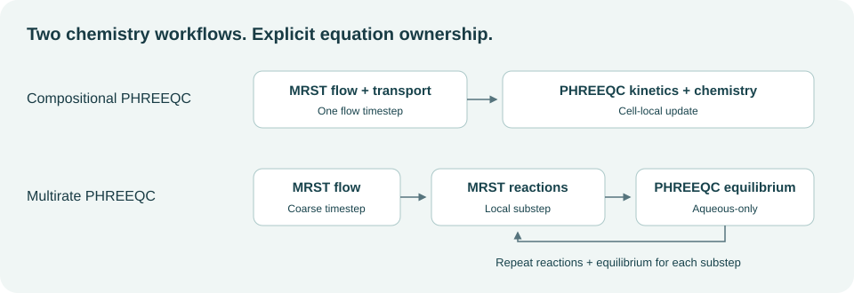
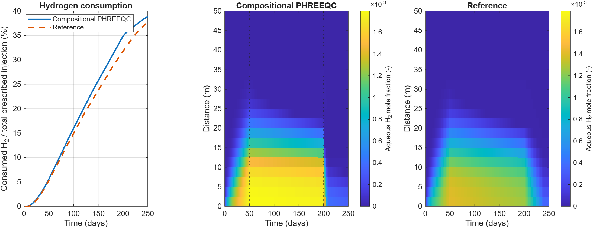
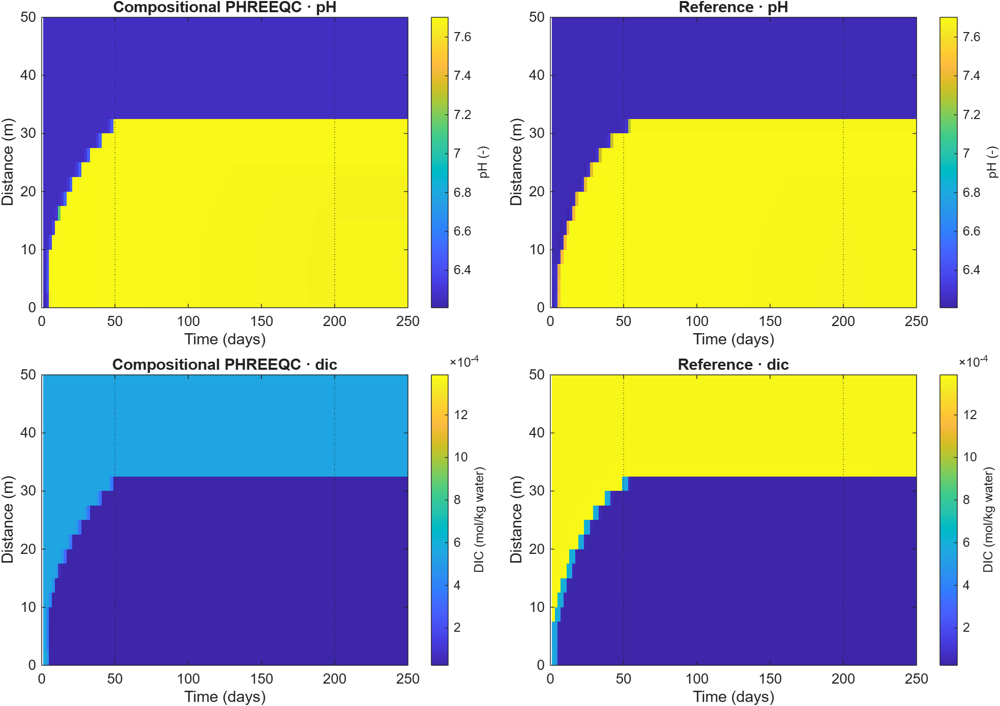
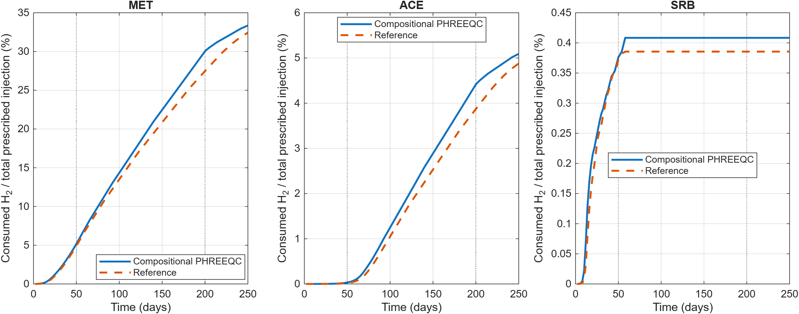
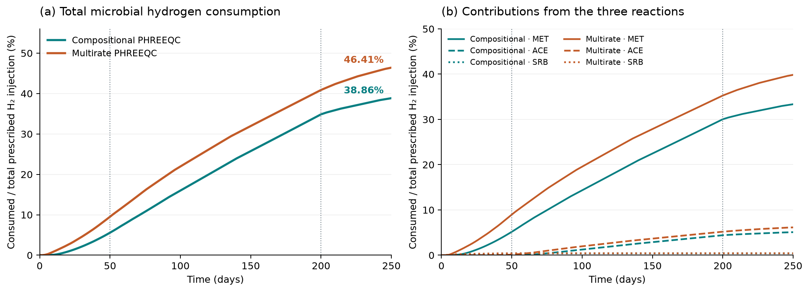
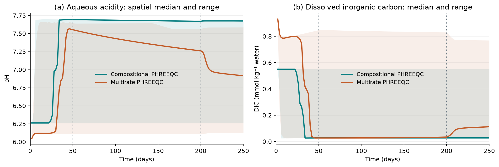

PHREEQC coupling
================

Platform support
----------------

H2sim supports both sequential backends on **Linux
MATLAB** through PhreeqcMatlab's native IPhreeqc library and on **Windows
MATLAB** through IPhreeqcCOM. Linux does not need a COM server.
A full native-Linux MATLAB regression run is not recorded in the latest
:doc:`verification` record. See :ref:`optional-phreeqc-setup` for installation, runtime
requirements, and a verification command.

.. raw:: html

   <a class="phreeqc-brand" href="https://www.usgs.gov/software/phreeqc-version-3" aria-label="PHREEQC — official USGS software page"><strong>PHREEQC</strong><small>USGS geochemical software ↗</small></a>

Initialize with ``startupH2sim('phreeqc', true)`` before running chemistry
examples, or call ``initializeH2simPhreeqc`` after core startup. Linux batch
runs should use ``bash run_matlab_h2sim.sh --phreeqc "MATLAB statements"``
to configure the native-library runtime before MATLAB starts.

Two supported chemistry workflows share MRST flow and EOS gas–liquid
partitioning, but assign microbial kinetics differently.

.. list-table:: Workflow ownership
   :header-rows: 1
   :widths: 25 25 25 25

   * - Workflow
     - Flow / transport
     - Microbial kinetics
     - Equilibrium chemistry
   * - Compositional PHREEQC
     - MRST
     - Cell-local PHREEQC kinetics
     - PHREEQC after a flow timestep
   * - Multirate PHREEQC
     - Coarse MRST flow step
     - MRST local reaction substeps
     - Aqueous-only PHREEQC after each reaction substep

Complete-cycle validation
-------------------------

.. code-block:: matlab

   result = runPhreeqcValidation( ...
       'gridCells', 20, 'totalDays', 250, 'rate', 'highrate');
   plotCompositionalPhreeqcValidation(result);

The command above runs H2sim without an external checkout. The reference
curves on this page are retained comparison data; reproducing that external
run is optional, as described below.

The selected comparison uses a 20-cell, 50 m column and a complete 250-day
cycle: 50 days of injection, 150 days of storage, and 50 days of production.
Both implementations use Soreide–Whitson thermodynamics at 2.865 mol/kg NaCl
and the high-rate MET/ACE/SRB parameter set. H2sim applies one chemistry split
per 2-day flow step; the reference uses five chemistry substeps. Diffusion,
dispersion, bacterial diffusion, chemotaxis, and bioclogging are disabled.
Use a smaller even ``totalDays`` value for a prefix of this same schedule,
for example ``totalDays=2`` to check the first flow/chemistry step.
The saved full-cycle results replace the earlier 50-day, moderate-rate example.

All consumption percentages use the **total prescribed hydrogen injection**
as a fixed denominator, including at earlier times. The prescribed gas
volume is converted to a nominal ideal-gas amount at the facility reference
conditions (101325 Pa and 288.15 K). This differs from normalization by
cumulative injection at each plotted time. Consumption is a reaction-source
quadrature diagnostic, not an independent well-inventory deficit; dissolution
and unrecovered gas are excluded.

   Hydrogen consumption and dissolved-H₂ evolution over the complete cycle.
   Vertical lines mark the day-50 and day-200 control changes.

.. list-table:: Consumed hydrogen (% of total prescribed injection)
   :header-rows: 1

   * - Implementation
     - Day 50
     - Day 200
     - Day 250
   * - Compositional PHREEQC
     - 5.577
     - 34.862
     - 38.857
   * - Reference
     - 5.303
     - 31.728
     - 37.704

Conversion continues during storage without fresh injection. The final
compositional result exceeds the reference by 1.153 percentage points.
These results retain the measured discrepancy; they do not demonstrate
splitting or spatial convergence. H2sim tracks acetate as an EOS component,
whereas the reference uses nitrogen and separate aqueous organic-carbon
bookkeeping.

Geochemical evolution
~~~~~~~~~~~~~~~~~~~~~

   pH and total dissolved inorganic carbon (DIC) over 250 days. Color limits
   are shared between implementations for each observable. DIC is total
   inorganic-carbon molality, not only dissolved CO₂; the reference records
   it directly from PHREEQC selected output.

The pH and DIC fronts show how reactive aqueous chemistry evolves throughout
injection, storage, and production. Similar bulk consumption does not imply
identical spatial chemistry. The compositional run records 87 cell-step
element-audit failures, with a maximum absolute residual of 3.61 × 10⁻⁵ mol.
The reference does not expose the same elemental audit. These limitations
remain part of the comparison.

Consumption by reaction
~~~~~~~~~~~~~~~~~~~~~~~

   Separate MET, ACE, and SRB contributions, each normalized by total
   prescribed hydrogen injection. Their sum equals the total-consumption
   curve for the corresponding implementation.

At day 250, the compositional contributions are 33.357% (MET), 5.092% (ACE),
and 0.408% (SRB), compared with 32.439%, 4.879%, and 0.386% in the reference.
All plots use the full 0–250-day interval. Setups and accepted outputs remain
saved as packed simulations; the plotting function also exports the loss
history as CSV and every figure as PNG and vector PDF.

.. button-ref:: notebooks/phreeqc_validation
   :color: primary

   Open PHREEQC validation →

The external reference data shown on this page were generated with
`UGFACT <https://github.com/ahmadrezashojaee/UGFACT>`_ by Ahmadreza Shojaee.
The standalone case and ``runThreeBackendComparison`` require no external
checkout. To reproduce those external reference data, explicitly request the
optional comparison:

.. code-block:: matlab

   comparison = runPhreeqcValidation('referenceRoot', referenceRoot, ...
       'gridCells', 20, 'totalDays', 250, 'rate', 'highrate');

Only this optional reference uses a separate checkout and Windows COM. Its
files and platform are checked before H2sim simulations start. Sources are
staged locally, and the adapter retains the reference kinetic equations.

Compositional kinetic coupling
------------------------------

Set ``phreeqcBackend='sequential-compositional-phreeqc'`` and enable timestep
coupling. PHREEQC integrates MET, ACE, and SRB kinetic amounts locally. MRST's
implicit microbial source terms are disabled to prevent double counting.
Aqueous tracers remain transported in MRST.

.. code-block:: matlab

   comparison = exampleCompositionalBacterial1DPhreeqcMinerals( ...
       'gridCells', 4, 'maximumFlowSteps', 2);

This four-cell, two-step run checks setup and chemistry execution. The default
example runs the complete 50-day injection period on 50 cells, comparing a
microbial biochemistry baseline with Bentheimer, Berea and Grey Berea mineral
inventories. It is a comparison of reaction backends as well as minerals;
differences from the baseline cannot be attributed to mineral chemistry alone.
Returned hydrogen consumption is in mol, and spatial loss is normalized by
total prescribed injected hydrogen. Packed simulations reuse matching caches.

Batches reduce IPhreeqc call overhead. The example's default ``batchSize`` is
50; pass ``'batchSize', 1`` to this example for individual cell calls. The
underlying setup option is ``sequentialCompositionalPhreeqcBatchSize``.
Inactive-cell skipping records an explicit execution mask; a skipped identity
update is not an independently evaluated chemistry audit.

.. button-ref:: notebooks/mineral_comparison
   :color: primary

   Open the mineral chemistry setup check →

Three-backend comparison
------------------------

``runThreeBackendComparison`` runs three included H2sim formulations through
injection, storage and production. Its default 50-cell, 250-day comparison is
longer than a dependency check and requires no external reference checkout.
The first case retains a reduced carbonate buffer with PHREEQC reactions off;
the second uses PHREEQC microbial kinetics; the third uses multirate MRST
microbial kinetics with PHREEQC equilibrium. Biomass and decay conventions also
differ, so this comparison does not isolate mineral effects alone.

.. code-block:: matlab

   scenarios = runThreeBackendComparison('plotResults', false);
   save('three_backend_comparison.mat', 'scenarios', '-v7');

The first two cases use two-day flow steps. ``flowTimestepMaxDt`` and
``reactionSubstepMaxDt`` control only the multirate case (defaults: two days
and 0.4 day). Result profiles use the last injection, last storage and final
states. Aqueous H2 is a liquid mole fraction; DIC is in mol/kgw. The time-dependent
hydrogen loss uses total scheduled injected H2 as its denominator, including
during injection. Historical MRST-prefixed labels identify H2sim results here;
they do not select MRST's separate biochemistry module.

Save the returned array explicitly to redraw without solving again:

.. code-block:: matlab

   saved = load('three_backend_comparison.mat', 'scenarios');
   plotPhreeqcBackendComparison(saved.scenarios, ...
       'outputDirectory', fullfile(pwd, 'build', 'backend-figures'));

The driver retains simulations in memory and exports three PDF/PNG figures
when plotting is enabled; it does not write a packed simulation archive.

Multirate aqueous equilibrium
-----------------------------

The multirate model follows each coarse flow step with bounded local MRST
microbial reaction substeps. PHREEQC equilibrates aqueous/mineral chemistry
after each substep and refreshes the kinetic feedback. Its input contains
no PHREEQC ``RATES`` or ``KINETICS`` blocks.

.. code-block:: matlab

   summary = exampleSequentialBiochemistryPhreeqc1D( ...
       'maximumFlowSteps', 2, 'plotResults', true, ...
       'phreeqcReflashParallel', false);

The example uses 50 cells over 50 m. Biomass starts at ``N/N0=1`` with
``N0=1e9 cells/kgw``, first-order decay and ``Nmax/N0=1e4``. Time options use
seconds; MRST's ``day`` converts days to seconds. The default complete schedule
contains 125 two-day flow steps with reaction substeps of at most 0.4 day.

Matching packed results are reused. ``maximumFlowSteps`` truncates the schedule
before packing, so changing the limit selects a different cache identity rather
than extending the previous run. ``simulationDirectory`` selects a packed-output
root; leaving it empty uses the normal H2sim output directory. Runtime includes
packing, simulation/cache access and output loading, excluding setup and plots.
A short run checks execution and does not reproduce a complete storage cycle.

To retain and redraw the returned summary explicitly:

.. code-block:: matlab

   save('multirate_summary.mat', 'summary', '-v7');
   saved = load('multirate_summary.mat', 'summary');
   plotSequentialBiochemistryPhreeqc(saved.summary, ...
       'outputDirectory', fullfile(pwd, 'build', 'multirate-figures'));

Summary hydrogen quantities are mol; ``h2LossPercent`` uses total prescribed
injection over the selected schedule as its denominator. The two plotted figures
show final flow/chemistry profiles and cumulative biological consumption.

``reactionSubstepMaxDt`` controls the local reaction cadence. Pressure
flashes run serially by default; Parallel Computing Toolbox is optional.
The separate ``simulateSequentialH2BiochemPhreeqc`` runner is an outer Picard
scheme, distinct from this coarse-flow multirate example.

The saved 20-cell comparison covers all 250 days of injection, storage, and
production. Final microbial consumption is 46.41% for multirate and 38.86%
for compositional PHREEQC, normalized by total prescribed H₂ injection.
The workflows differ in kinetic ownership, biomass representation, and
splitting; this is not a convergence test of reaction substepping alone.

   Full-cycle hydrogen consumption. Dotted lines mark day 50 and day 200.
   Percentages use total prescribed injection as a fixed denominator.

   Chemistry histories: lines are spatial medians, shading is the cellwise
   range. The notebook also compares pH and DIC space-time maps and reports
   the available conservation diagnostics.

.. button-ref:: notebooks/multirate_reactions
   :color: primary

   Open the full-cycle multirate comparison →

Three-cycle 2D storage
----------------------

Explore the completed layered storage comparison with compositional PHREEQC:
three cycles, hydrogen consumption by pathway, gas composition and pH maps,
and an interactive animation of hydrogen and microbial evolution.

.. figure:: _static/examples/phreeqc_2d_chemistry.png
   :alt: Third-injection gas H2, CO2, methane and aqueous pH maps in the layered coupled model.
   :width: 100%

   Spatial chemistry after the third injection period. The full example
   distinguishes mobile microbial transport from cell-local PHREEQC kinetics.

.. button-ref:: phreeqc_2d
   :color: primary

   Explore the 2D results and animation →

.. toctree::
   :hidden:

   phreeqc_2d

Conservation diagnostics
------------------------

The compositional backend records per-cell elemental inventories and warns
when configured tolerances are exceeded. Inspect ``phreeqcElementBalancePass``
and ``phreeqcElementBalanceEvaluatedCells``.

The current equilibrium-only implementation has its elemental audit disabled;
its post-equilibrium EOS component-inventory audit remains active. A passing
EOS audit alone does not establish elemental conservation across the chemistry
handoff. Backend comparisons may also change kinetic parameters and ownership;
a difference is not automatically a mineral or pH effect.

Profiling tools
---------------

.. code-block:: matlab

   results = profilePhreeqcWorkflows('backends', {'compositional'}, ...
       'collectProfiles', false, 'trials', 3);

Paired states and timings are saved under ``build/phreeqc-performance``.
Compare states and diagnostics before interpreting runtime improvements.
